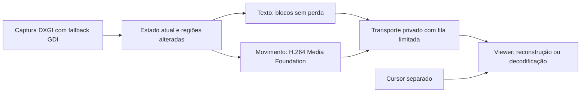

# Pesquisa: qualidade de imagem do TeamViewer e evolução do NexoDesk

Pesquisa realizada em 14/10/2026. Escopo: captura, detecção, compressão, transporte, apresentação e componentes reaproveitáveis. A implementação do aplicativo não foi alterada.

## 1. Recomendação

**Evoluir a arquitetura existente com DXGI Desktop Duplication e Media Foundation, acessados por Vortice. Preservar transmissão sem perda para trabalho de escritório e acrescentar H.264 por hardware para movimento.** Antes de escolher parâmetros do codec, medir e corrigir a espera serial por confirmação de cada lote.

Há componentes prontos para captura, codificação e decodificação. Não encontrei um pacote gratuito, mantido e diretamente plugável em C#/.NET 10 que entregue sozinho toda a experiência do TeamViewer, incluindo desktop seguro, texto fiel, adaptação e viewer WPF. Aplicações completas e SDKs comerciais exigem outra integração ou arquitetura.

| Pergunta | Resultado |
|---|---|
| TeamViewer usa H.264? | **Sim, há confirmação oficial em determinadas conexões.** Não demonstra que toda sessão use H.264 ou que seja seu único codec. |
| Envia apenas pequenos quadros alterados? | Há indícios históricos de blocos e cache. O tamanho, algoritmo atual e combinação com H.264 não estão publicados nas fontes encontradas. |
| Detecta uma alteração minúscula? | Regiões alteradas informadas pelo sistema operacional ou comparação integral dos pixels permitem isso. Não exigem diminuir a resolução. |
| Detectar garante exibir fielmente? | **Não.** Compressão com perda, subamostragem de cor, descarte e escala podem eliminar detalhes depois de detectados. |
| Podemos reaproveitar algo pronto? | **Sim:** Vortice/DXGI/Media Foundation são a combinação inicial recomendada; libwebrtc é a alternativa se quisermos substituir também o transporte. |

Esta é uma avaliação de engenharia baseada no código local e nas fontes abaixo. Não é um benchmark comprovando equivalência com o TeamViewer.

## 2. O que sabemos sobre o TeamViewer

### Documentação oficial

1. **H.264 existe no produto.** O changelog do macOS 15.45.3, lançado em 22/08/2023, registra melhoria na transmissão H.264 em conexões de macOS para Windows. Rejeita a afirmação de que TeamViewer nunca usa H.264; não identifica perfil, formato de cor, encoder ou modo em Windows para Windows. [Changelog oficial](https://community.teamviewer.com/English/discussion/131514/macos-v15-45-3/p1).
2. **A compressão se adapta à conexão.** O anúncio do TeamViewer 14 descreve detecção de pouca banda e ajuste automático da compressão, além de melhorias na infraestrutura. Confirma o comportamento, mas não publica o algoritmo. [Anúncio oficial](https://www.teamviewer.com/en-us/global/company/press/2018/teamviewer-releases-teamviewer-14-final/).
3. **Há processamento de imagem acelerado.** A equipe descreve aceleração por hardware no processamento de imagem. Isso não prova que todo caminho use NVENC nem identifica a API de captura. [Publicação da equipe](https://community.teamviewer.com/English/discussion/11063/~/English/kb/product-updates).
4. **Movimento recebe tratamento específico.** O manual 12 descreve reconhecimento de imagens em movimento e otimização da transmissão. O manual 15 documenta profundidade de cor e compressão com perda. Não revelam a composição interna atual. [Manual 12, seção 9.7](https://download.teamviewer.com/docs/en/v12/TeamViewer12-Manual-Remote-Control-en.pdf), [manual 15, seção 13](https://dl.teamviewer.com/docs/en/v15/TeamViewer-Manual-Remote-Control-en.pdf).

### Por que há fontes dizendo que o codec é proprietário

A FAQ do NVIDIA Capture SDK 7.0 descreve compressão proprietária do TeamViewer e ausência de uso do motor NVENC H.264 naquele contexto. É uma descrição histórica, anterior ao changelog acima. Não caracteriza necessariamente o produto atual. Também é possível usar H.264 sem usar especificamente NVENC. [FAQ NVIDIA, pergunta 16](https://developer.download.nvidia.com/designworks/capture-sdk/docs/7.0/NVIDIA-Capture-SDK-FAQ.pdf).

### Indício de blocos e cache

Logs publicados por usuários no fórum do fornecedor contêm `Desktopencoding: Tiles` e `Tile caching activated`. São registros antigos fornecidos por terceiros: **indício operacional, não especificação oficial nem comprovação da arquitetura atual**. Não permitem concluir tamanho dos blocos, comparação pixel a pixel ou reprodução sem perda. [Registro público de 2017](https://community.teamviewer.com/English/discussion/8769/~/English/kb/product-updates).

**Não foi possível determinar publicamente:** todos os codecs atuais; critérios de seleção; tamanho dos blocos; limiares de comparação; formato do cache; uso de 4:4:4; refinamento; ou protocolo exato de confirmação/recuperação. Logs de uma versão instalada podem identificar o modo daquela sessão, mas não substituem uma especificação do fabricante.

## 3. Atualizações parciais e codec de vídeo são coisas diferentes

### Atualizações por região

O receptor guarda uma imagem completa. O remetente envia pixels novos apenas de certos retângulos. Ao alterar uma letra, atualiza a região da letra. As coordenadas permanecem na resolução original: **enviar menos área não significa reduzir resolução**.

Outra otimização transmite um comando de cópia: ao mover uma janela, o receptor reutiliza os pixels já armazenados e recebe somente áreas repintadas. A Desktop Duplication API oferece regiões modificadas e regiões movidas. As movimentações devem ser aplicadas antes dos novos pixels, usando a base anterior. [Documentação DXGI](https://learn.microsoft.com/en-us/windows/win32/direct3ddxgi/desktop-dup-api).

### Predição temporal

H.264, VP9 e AV1 mantêm imagens de referência e codificam previsões, movimentos e diferenças. O quadro reconstruído tem dimensões completas, embora regiões previsíveis custem poucos bits. Um quadro P não equivale a um JPEG recortado enviado pelo aplicativo.

Normalmente não se abre um encoder H.264 para cada bloco de 128×128: conserva-se um fluxo contínuo, aproveitando referências temporais. Blocos do codec e blocos do protocolo são diferentes. Regiões de interesse e mapas de atividade ajudam quando a implementação efetivamente os oferece. [Recursos do NVENC](https://docs.nvidia.com/video-technologies/video-codec-sdk/13.0/nvenc-video-encoder-api-prog-guide/).

### Exemplo verificável: Chromium remoting

O código público demonstra uma combinação concreta:

- Prepara a imagem e alimenta um mapa de atividade do encoder VP8/VP9 a partir da região atualizada.
- Separa configuração de codificação sem perda da preservação da resolução dos componentes de cor.
- Expande regiões por causa dos filtros e alinha aos blocos esperados pelo encoder.
- Permite quadros adicionais de refinamento mesmo quando a captura não mudou.

Isso demonstra que atualização parcial e vídeo podem coexistir. **São técnicas verificadas no Chromium, não descobertas sobre o código fechado do TeamViewer.** [Encoder VPX](https://chromium.googlesource.com/chromium/src/+/refs/heads/main/remoting/codec/webrtc_video_encoder_vpx.cc?pli=1%2F%2F), [contrato de refinamento](https://chromium.googlesource.com/chromium/src/+/HEAD/remoting/codec/webrtc_video_encoder.h).

## 4. Como não perder alterações pequenas

### Detecção espacial

**Opção preferida: metadados DXGI.** O Windows informa regiões atualizadas. Pode agrupar regiões e indicar uma área maior do que a efetivamente modificada; isso aumenta o trabalho, mas conserva cobertura das atualizações acumuladas. A API fornece pixels, movimentações e informações do cursor. [Visão geral da captura](https://learn.microsoft.com/en-us/windows-hardware/drivers/display/desktop-duplication-api), [metadados por quadro](https://learn.microsoft.com/en-us/windows/win32/api/dxgi1_2/ns-dxgi1_2-dxgi_outdupl_frame_info).

**Alternativa: comparação integral.** Comparar todos os bytes relevantes da captura original com a referência. A comparação pode ser por blocos e parar ao encontrar a primeira diferença: já sabemos que aquele bloco precisa ser enviado. Detecta mudança de um canal de um pixel, sem limiar perceptual.

O WebRTC tem uma implementação pública por blocos, incluindo comparações de memória para regiões parciais. O wrapper examina regiões candidatas informadas pelo capturador; a cobertura também depende de essas regiões estarem corretas. [DesktopCapturerDifferWrapper](https://webrtc.googlesource.com/src/+/refs/heads/main/modules/desktop_capture/desktop_capturer_differ_wrapper.cc).

Evitar decidir mudança apenas por amostras esparsas, imagem reduzida ou média de diferenças: um ponto decimal pode ficar fora da amostra ou abaixo do limiar. Hash de todos os bytes evita o problema da amostragem, mas admite colisões; comparação exata elimina essa dependência.

### Detecção temporal

Nenhum desses mecanismos garante transmitir toda imagem intermediária entre duas capturas. Uma alteração que aparece e desaparece pode ser consolidada no estado final. Para controle remoto, o objetivo geralmente é **mostrar o estado atual corretamente com pouco atraso**; isso é diferente de gravar toda transição.

A garantia de um pixel pressupõe que a alteração esteja na captura e continue representada no estado enviado. Mais FPS reduz o intervalo de observação, mas não registra todos os eventos.

### Entrega correta

Requisitos propostos para uma futura implementação:

1. Detectar sobre a captura original, antes de compressão e conversão com perda.
2. Preservar a base que o receptor tem ou todas as atualizações necessárias para alcançá-la.
3. Ao coalescer capturas, acumular regiões pendentes ou comparar novamente com a referência adequada. Não avançar a referência e esquecer um delta ainda não entregue.
4. Identificar geração de sessão/modo/resolução e sequência; rejeitar atualizações antigas.
5. Na perda de base, reinicializar com imagem completa para blocos ou quadro independente para vídeo.
6. Definir verificação de coerência/full refresh a partir dos testes, sem tratar um intervalo arbitrário como garantia.

Em vídeo, descartar um quadro já codificado pode quebrar referências posteriores; o descarte precisa ser coordenado. Descartar uma captura antes de codificá-la é outra operação. UDP exige recuperação de perdas; TCP entrega ordenadamente, mas retransmissões podem aumentar atraso. [Recuperação e referências no NVENC](https://docs.nvidia.com/video-technologies/video-codec-sdk/13.0/nvenc-video-encoder-api-prog-guide/).

## 5. Por que alta resolução ainda pode produzir texto ruim

| Etapa | Problema | Direção recomendada |
|---|---|---|
| Captura | Redução antes de comparar/codificar | Preservar resolução original. |
| Conversão de cor | 4:2:0 compartilha informação de cor entre pixels | RGB/BGR sem perda para fidelidade; avaliar 4:4:4 quando suportado. |
| Quantização | O codec aproxima diferenças pequenas | Configuração própria para tela; refinamento ou modo sem perda. |
| Banda | Redução automática de resolução | Para texto, preferir reduzir FPS antes de resolução. |
| Apresentação | Ajuste à janela reduz uma imagem nítida | Comparar em 100%, com DPI/escala controlados. |
| Filas | Imagem boa chega atrasada | Medir idade da imagem, não apenas FPS. |

4:4:4 preserva resolução dos componentes de cor; não significa automaticamente compressão sem perda. Codificação “lossless” de uma imagem previamente convertida para 4:2:0 não recupera as cores descartadas. Para fidelidade byte a byte aos pixels capturados, transmitir RGB/BGR sem perda continua sendo a referência direta.

A Microsoft documenta no RDP separação por conteúdo, codec próprio para texto, AVC/H.264 e escolhas de 4:2:0/4:4:4. É um exemplo publicado de adaptação a desktop, não uma especificação do TeamViewer. [Codificação gráfica do RDP](https://learn.microsoft.com/en-us/azure/virtual-desktop/graphics-encoding).

O W3C distingue movimento, detalhe e texto e orienta preservar resolução quando legibilidade importa. `contentHint="text"` orienta a implementação; não garante reprodução exata. [MediaStreamTrack Content Hints](https://www.w3.org/TR/mst-content-hint/).

## 6. Diagnóstico do NexoDesk atual

Inspeção do código local, com árvore Git inicialmente limpa:

| Elemento | Situação encontrada | Implicação |
|---|---|---|
| Plataforma | C#/.NET 10, Windows x64, WPF | Favorece bibliotecas .NET/APIs Windows. |
| Rede | TCP/mTLS em LAN ou Tailscale | WebRTC não é necessário apenas para acrescentar H.264. |
| Captura | GDI e cópia integral para CPU | O custo de captura/comparação persiste com pouca mudança. |
| Modo principal 1.1.0 | Blocos de até 128×128 BGR32 + Brotli | Pixels transmitidos sem perda e sem redução de resolução. |
| Detecção principal | `SequenceEqual` por linha até encontrar diferença | Detecta um pixel alterado presente na captura; não amostra. |
| JPEG legado | Hash amostra um byte a cada sete | Pode ignorar mudança fora da amostra; não é a detecção principal. |
| Confirmação | Próximo lote espera `FrameAck` do anterior | Potencial gargalo, sobretudo com vários lotes por captura. |
| Cursor | Mensagem separada | Já evita recodificação da tela ao mover o ponteiro. |
| Viewer | `WriteableBitmap.WritePixels`, opção 100% | Serve aos blocos; vídeo por hardware requer novo caminho. |

Referências: [encoder diferencial](../src/NexoDesk.Shared/Streaming/DesktopTileEncoder.cs), [captura e legado](../src/NexoDesk.Desktop/ScreenCapture.cs), [agendamento](../src/NexoDesk.Desktop/DesktopThread.cs), [envio/ACK](../src/NexoDesk.Shared/Session/AgentSession.cs), [apresentação](../src/NexoDesk.App/ViewModels/SessionViewModel.cs).

### Gargalo da confirmação

O remetente espera aplicação do lote no viewer antes do próximo. Uma captura com vários lotes paga vários tempos de ida e volta, além de transmissão, descompressão e aplicação.

**Exemplo teórico, não medido:** RTT de 50 ms e quatro lotes por captura limitam esse mecanismo a aproximadamente 5 capturas/s antes dos demais custos. RTT é o tempo de ida e volta da rede.

Essa espera limita a fila, mas existem outras opções: janela pequena de lotes em trânsito, limite por bytes/idade, confirmação acumulada e coalescência correta. Remover toda confirmação sem substituir o controle pode recriar atraso acumulado.

TCP já assegura ordem dos bytes, mas não informa quando o viewer aplicou a atualização. Aplicar pixels no callback WPF em prioridade de renderização também não comprova o instante exato de exibição no monitor. A medição visual precisa distinguir isso.

### Verificação realizada

Executados os testes existentes, sem criar testes novos:

```powershell
dotnet test tests/NexoDesk.Shared.Tests/NexoDesk.Shared.Tests.csproj -c Release --no-restore --filter FullyQualifiedName~DesktopUpdateTests --verbosity minimal
```

**Nove aprovados, zero falhas.** Incluem um pixel alterado, tela inalterada, reconstrução exata dividida em lotes, mudança de resolução e correspondência de confirmação. Não medem captura real, GPU, tráfego entre PCs ou qualidade do TeamViewer.

## 7. O que existe pronto

As licenças são as declaradas nas fontes consultadas. A composição depende também das versões e bibliotecas nativas distribuídas. Código disponível publicamente não torna as licenças equivalentes.

| Solução | O que resolve | Licença declarada | Adequação |
|---|---|---|---|
| **Vortice.Direct3D11 + DXGI + MediaFoundation** | Bindings .NET para GPU, captura e mídia | MIT | **Recomendado.** Componentes, não motor completo. |
| ScreenCapture.NET.DX11 | Captura pronta via Desktop Duplication | LGPL-2.1-only no pacote | Protótipo rápido; verificar metadados/texturas, GPU híbrida e desktop seguro. |
| screen_capture_lite | Captura C++, callbacks de mudanças/cursor, exemplos C# | MIT | Exige interop e validação; não inclui toda a mídia/rede. |
| libwebrtc / webrtc-sdk | Codecs, transporte de mídia, congestionamento, captura | WebRTC BSD; wrapper MIT; dependências próprias | Alternativa abrangente. Não presumir C#, hardware ou 4:4:4 sem verificar build. |
| libdatachannel | Transporte WebRTC e canais de dados/mídia | MPL-2.0 atual | Não substitui captura/encoder/decoder; precisa integrar mídia/controle de taxa. |
| FFmpeg + binding .NET | Conversão/codecs, backends de hardware | LGPL/GPL conforme build | Útil para experimentos; licença do binding não define a do FFmpeg nativo. |
| RustDesk | Aplicação completa | AGPL-3.0 no repositório principal | Comparador ou base de fork; não é pacote plugável em WPF. |
| Remotely | Aplicação de acesso remoto .NET | GPL-3.0 atual | Outra base, com servidor/frontend próprios. |
| IronRDP | Protocolo RDP modular, cliente/servidor e bindings .NET | MIT/Apache-2.0 | Se escolhermos RDP; não presumir AVC444 completo. |
| LibVNCServer/Client | Implementação VNC | GPL-2.0 ou posterior | Outra arquitetura e condições de distribuição. |
| TightVNC Remote Core SDK .NET + servidor licenciado | Viewer WPF/WinForms e VNC comercial | Comercial; servidor separado | Candidato para comprar um motor; validar .NET 10, movimento e transporte privado. |

Fontes: [Vortice](https://github.com/amerkoleci/Vortice.Windows), [MediaFoundation NuGet](https://www.nuget.org/packages/Vortice.MediaFoundation), [ScreenCapture.NET](https://github.com/DarthAffe/ScreenCapture.NET), [licença DX11](https://github.com/DarthAffe/ScreenCapture.NET/blob/master/ScreenCapture.NET.DX11/ScreenCapture.NET.DX11.csproj), [screen_capture_lite](https://github.com/smasherprog/screen_capture_lite), [WebRTC SDK](https://github.com/webrtc-sdk/webrtc), [releases do wrapper](https://github.com/webrtc-sdk/libwebrtc/releases), [licença do wrapper](https://github.com/webrtc-sdk/libwebrtc/blob/main/LICENSE), [libdatachannel](https://github.com/paullouisageneau/libdatachannel), [FFmpeg](https://ffmpeg.org/legal.html), [RustDesk](https://github.com/rustdesk/rustdesk), [Remotely](https://github.com/immense/Remotely), [IronRDP](https://github.com/Devolutions/IronRDP), [LibVNC](https://github.com/LibVNC/libvncserver), [SDK TightVNC](https://www.tightvnc.com/licensing-dotnetviewersdk.php), [licenciamento TightVNC](https://www.tightvnc.com/licensing.php).

### Aproveitamento concreto

- **Windows DXGI:** captura e metadados já implementados pelo sistema.
- **Media Foundation:** encoders/decoders existentes, enumerando hardware disponível e fallback.
- **Vortice:** interoperabilidade .NET, evitando declarar manualmente todas as interfaces.
- **Brotli/protocolo atuais:** preservar texto sem perda enquanto validamos vídeo.

O pacote publicado Vortice.MediaFoundation consultado foi 3.8.3, alvo .NET 8 ou superior. Sua existência/compatibilidade declarada foi verificada; **não foi instalado nem integrado**. Não misturar versões arbitrárias entre pacotes Vortice. [Registro NuGet](https://www.nuget.org/packages/Vortice.MediaFoundation).

A Media Foundation distingue hardware por enumeração. Usar H.264 não prova seleção de hardware: confirmar formatos, perfil, baixa latência, driver e saída. O encoder Microsoft documentado não oferece promessa geral de H.264 4:4:4/RGB sem perda. [Enumeração de MFTs](https://learn.microsoft.com/ga-ie/windows/win32/medfound/registering-and-enumerating-mfts), [encoder H.264](https://learn.microsoft.com/en-us/windows/win32/medfound/h-264-video-encoder).

### O que não é um motor diretamente incluível

A API pública TeamViewer administra conta, sessões, contatos e relatórios. A documentação consultada não oferece seu codec como biblioteca independente. Integrar por API/linha de comando continua dependendo do produto TeamViewer. [API oficial](https://www.teamviewer.com/en/global/support/knowledge-base/teamviewer-classic/integrations/core-integrations/teamviewer-api/), [desenvolvedores](https://www.teamviewer.com/en/global/support/for-developers/).

DeskRT é o codec proprietário do **AnyDesk**, não o nome da compressão do TeamViewer. [Informação oficial](https://anydesk.com/en/ai-info).

Não iniciar pelo Microsoft MixedReality-WebRTC: arquivado em 2022. SIPSorcery é candidato técnico .NET, mas a licença atual tem restrição adicional; não o classificar simplesmente como BSD permissivo. [MixedReality-WebRTC](https://github.com/microsoft/MixedReality-WebRTC/), [SIPSorcery](https://github.com/sipsorcery-org/sipsorcery).

## 8. Arquitetura e critérios para implementação

### Opção recomendada: mídia nativa na base atual



Na primeira evolução, alternar **o modo da tela completa**, com transição explícita e nova base. Evita implementar imediatamente composição concorrente de vídeo/blocos. Quando o movimento parar, impedir apresentação de quadros antigos de vídeo e restaurar uma base sem perda antes de retomar deltas.

A seleção automática deve considerar frequência/área de mudança, tempo de codificação, banda e idade da fila. Usar histerese — critérios diferentes para entrar/sair de um modo — para evitar alternância a cada quadro. Prazos/limiares devem vir dos testes; não existe valor universal público para copiar do TeamViewer.

Mais adiante, se as medições justificarem, separar regiões: vídeo em uma janela e blocos no restante. Exige geração e prioridade de composição para impedir que vídeo atrasado sobrescreva texto refinado.

DXGI precisa recriar recursos em troca de desktop/resolução ou perda de acesso. A Microsoft documenta LOCAL_SYSTEM para desktop seguro. O agente já roda como SYSTEM na sessão física, mas isso **não comprova que DXGI ou wrappers funcionem em login/UAC**. Conservar fallback GDI até validar. Windows.Graphics.Capture é outra opção; regiões alteradas modernas dependem da versão do Windows. [DuplicateOutput e privilégios](https://learn.microsoft.com/en-us/windows/win32/api/dxgi1_2/nf-dxgi1_2-idxgioutput1-duplicateoutput), [DirtyRegions WGC](https://learn.microsoft.com/en-us/uwp/api/windows.graphics.capture.direct3d11captureframe.dirtyregions?view=winrt-26100).

### Segunda opção: libwebrtc

Escolher se priorizarmos transporte de mídia padronizado, congestionamento e futura compatibilidade com navegador. Reaproveita mais da pilha, mas exige código nativo, autenticação, sinalização, viewer e desktop seguro. Tailscale não obriga STUN/TURN; mudanças precisam respeitar a rede privada já definida.

### Verificações antes de decidir definitivamente

1. **Comparação reproduzível:** mesmos PCs, resolução, escala, tarefa e qualidade; registrar versão/rota de cada produto. Não confundir ganho de rota com ganho de codec.
2. **Instrumentar o caminho atual:** captura, comparação, compressão, envio, ACK, descompressão e aplicação. Medir atraso visual quando possível e percentis, não só média/FPS.
3. **Prototipar captura:** DXGI via Vortice ou ScreenCapture.NET; custo, metadados, GPU híbrida, monitor desligado, bloqueio, UAC e resolução.
4. **Prototipar H.264:** hardware utilizado, baixa latência, formatos/perfis do decoder e descarte seguro antes da codificação; banda e CPU/GPU.
5. **Comparar políticas:** sem perda com janela limitada versus alternância sem perda/H.264; teste de texto em 100%.
6. **Validar transições:** um pixel persistente, texto colorido pequeno, cursor de texto, planilha, rolagem, janela arrastada, vídeo e retorno ao estado parado. Comparar convergência sem perda com pixels capturados.
7. **Redes controladas:** LAN/Tailscale, diferentes RTTs/bandas/perdas. Metas numéricas de qualidade/atraso continuam por definir, sem presumir requisitos.

**Sequência sugerida:** corrigir confirmação serial conservando fila limitada; adotar DXGI; acrescentar H.264 por hardware como complemento. Reaproveita implementações prontas, conserva texto fiel e permite medir cada ganho.

Pendências: benchmark entre dois PCs; compatibilidade das bibliotecas com agente/viewer; seleção/licenciamento das versões; login/UAC; metas de aceitação. A composição exata do TeamViewer permanece proprietária e parcialmente não documentada.
